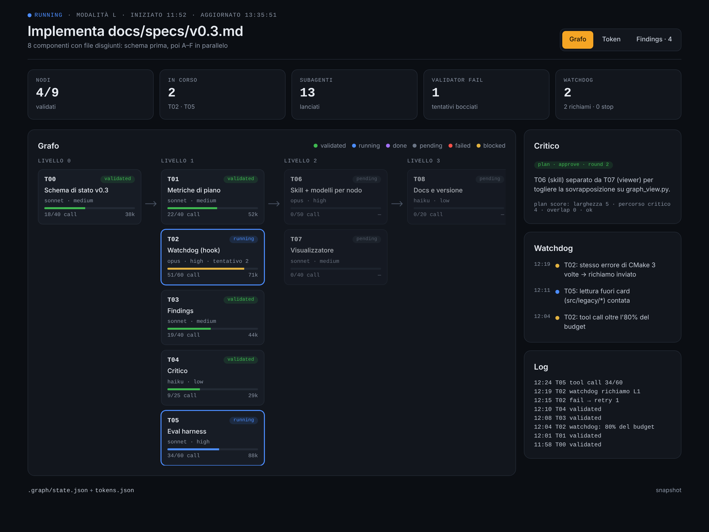
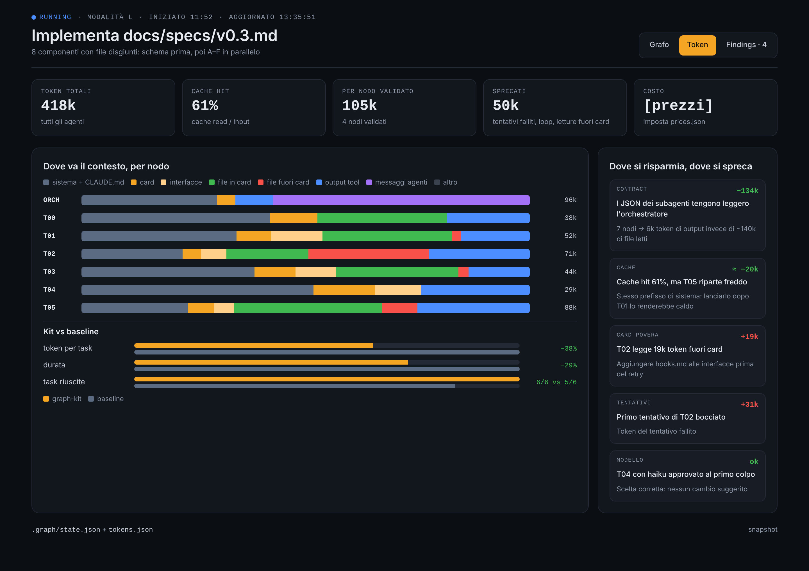
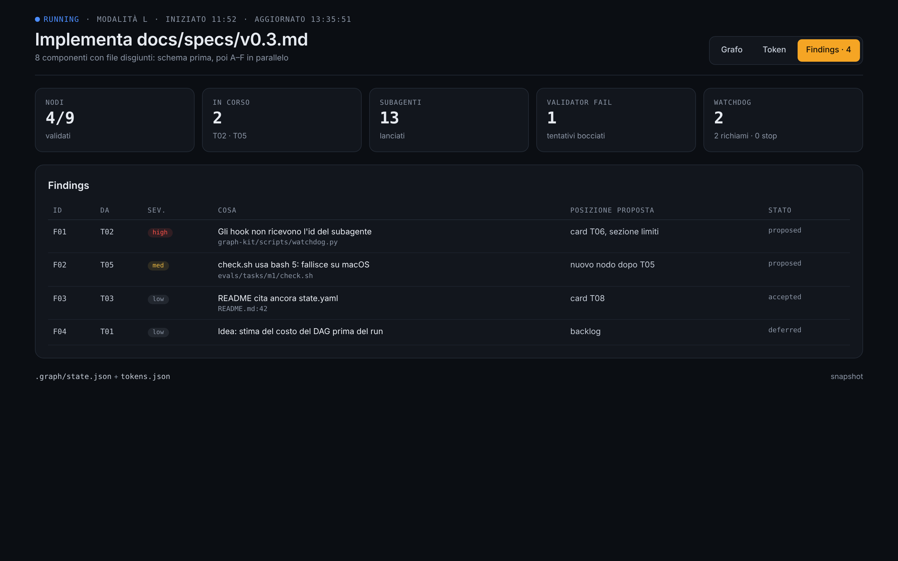
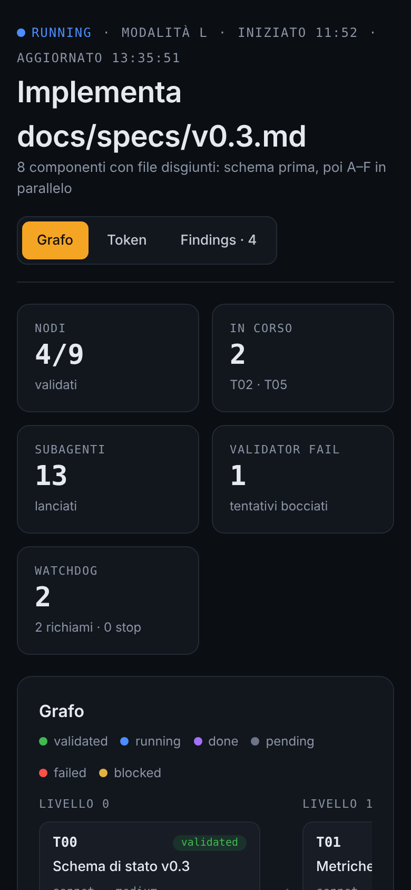

<div align="center">

# aitools

**Plugin per Claude Code che fanno lavorare gli agenti come un grafo:
contesto minimo, step in parallelo, ogni passo validato prima del successivo.**

`graph-kit` · `project-onboard`



</div>

---

## Perché

Un agente solo che fa tutto riempie il contesto, si perde nei dettagli e porta
avanti gli errori. `graph-kit` fa il contrario:

- **Sceglie da solo quanto lavoro serve.** Task piccola → la fa direttamente.
  Task grande → la scompone in un DAG e lancia gli agenti in parallelo.
- **Ogni agente vede solo la sua card.** Obiettivo, file che può toccare,
  criteri di accettazione. Niente esplorazione del repo.
- **Nessun errore passa al nodo successivo.** Un validator scettico controlla
  ogni nodo; si va avanti solo con `verdict: pass`.
- **Lo stato vive su file.** `.graph/state.json` è l'unica verità: se la
  sessione cade, il run riprende da dove era.
- **Vedi tutto, in tempo reale.** Il Run Viewer mostra grafo, token e findings
  mentre il run procede.

## Installazione

Dentro Claude Code, **una riga alla volta**:

```
/plugin marketplace add sjckness/aitools
/plugin install graph-kit@aitools
/plugin install project-onboard@aitools
```

Aggiornare: `/plugin marketplace update aitools`.

<details>
<summary>Senza il sistema dei plugin</summary>

```bash
curl -fsSL https://raw.githubusercontent.com/sjckness/aitools/main/install.sh | bash -s -- -g
```

Copia agenti, comandi e skill in `~/.claude`. Senza plugin non ci sono hook:
niente watchdog né aggiornamento live del viewer (usa `/graph-view`).
</details>

## Uso in 30 secondi

```
/onboard                                   # una volta per progetto: CLAUDE.md + mappa dei moduli
/graph-plan aggiungi i servizi load/start/abort al mission_manager_node
/run-graph                                 # esegue il piano approvato
/graph-view                                # apre il Run Viewer nel browser
```

`/graph-plan` è la modalità di pianificazione del kit: fa solo le domande che
cambiano il piano, confronta almeno due alternative (nodi, percorso critico,
token e tempo stimati), applica una checklist di ottimizzazioni spiegando ogni
scelta (interfacce condivise, file disgiunti, grana dei nodi, modello ed effort
per nodo, budget) e consegna un piano `planned` che `/run-graph` esegue senza
ripianificare. Per task piccole te lo dice e ti sconsiglia il grafo.

Altri comandi: `/graph-status` (stato senza eseguire nulla) e `/graph-eval --dry-run` (eval harness per confrontare le versioni del kit; carica il plugin del checkout con `--plugin-dir`).

Per le task grandi non serve nemmeno `/run-graph`: la skill
`graph-orchestration` si attiva da sola. Gli override hanno sempre la
precedenza:

```
/run-graph refactor del logger --mode M
/run-graph fix del parser, usa solo implementer e validator
```

## Come lavora

```
triage ──► S: inline ─────────────────► validator ─► fine
       ├─► M: scout ► impl ► validator ─────────────► fine
       └─► L: planner ► DAG ► [impl ► validator]×N ► reviewer ► fine
                                ▲          │ fail (max 2)
                                └──────────┘
```

| Agente | Modello | Effort | Cosa vede |
|---|---|---|---|
| planner | opus | high | il repo, una volta sola |
| scout | haiku | low | la card; estrae interfacce per gli altri |
| implementer | sonnet | medium | la card e i file elencati |
| validator | sonnet | high | card, JSON di output, diff |
| reviewer | opus | high | il diff aggregato |
| critic | fable | high | proposta, plan score o findings, goal — mai il codice |

Gli agenti si passano **file** in `.graph/` (card, interfacce, JSON di output),
non riassunti in chat. L'orchestratore legge solo i JSON: il suo contesto
cresce di poche centinaia di token per nodo, non di migliaia.

### Le difese del grafo

**Plan score.** Prima di eseguire, `plan_score.py` calcola metriche del DAG
(larghezza per livello, percorso critico, overlap di file tra nodi paralleli, token
per card). Se il verdetto è `reject` il run non parte; viene rilanciato sui nodi
aggiunti a run avviato.

**Watchdog.** Hook del plugin: livello 1 richiama l'agente e blocca le scritture
fuori dai `files` della card; livello 2 interviene se il pattern si ripete o il
budget supera il 125%; livello 3 tocca all'orchestratore, che decide sul nodo bloccato.
Gli hook attribuiscono ogni chiamata al nodo tramite `agent_id` (validator, critic,
reviewer, planner sono ignorati). La usage sta in `.graph/watchdog_state.json` e,
a nodo completato, `watchdog.py usage` la copia in `state.json`.

**Findings e backlog.** Gli agenti annotano cose fuori scope in `.graph/findings.jsonl`
invece di implementarle; a fine di ogni livello l'orchestratore fa dedupe e
propone cosa spostare nel backlog.

**Critico.** `critic` valuta in sola lettura piani, findings e nodi falliti e
risponde approve o object, con un modello diverso dall'orchestratore.

Schema di stato: [`graph-kit/docs/state-schema.md`](graph-kit/docs/state-schema.md). Limiti noti: [`graph-kit/docs/limitations.md`](graph-kit/docs/limitations.md).

## Run Viewer

Una pagina sola, tre viste. Si rigenera a ogni scrittura in `.graph/` (hook) e
si ricarica da sola mentre il run è in corso.

<table>
<tr>
<td width="50%"></td>
<td width="50%"></td>
</tr>
<tr>
<td><b>Token</b> — dove va il contesto di ogni nodo (sistema, card, file
dentro/fuori card, output dei tool, messaggi), kit vs agente singolo, e dove
si risparmia o si spreca.</td>
<td><b>Findings</b> — ciò che gli agenti trovano fuori scope: annotato, non
inseguito. Tu decidi se e dove entra nel piano.</td>
</tr>
</table>



**Grafo** — nodi per livello con stato, modello ed effort, tentativi, tool call
rispetto al budget e token. A lato: verdetto del critico, eventi del watchdog,
log.

Funziona anche dal telefono, e degrada con eleganza: con uno `state.json` della
v0.2 mostra il grafo; token e findings compaiono quando i file esistono.

Prova la demo senza lanciare nulla:

```bash
python3 graph-kit/scripts/graph_view.py --cwd examples/demo --open
```

<br clear="right">

## project-onboard

```
/onboard
/onboard solo f1tenth_behavior
```

Produce un `CLAUDE.md` corto (≈120 righe, caricato in ogni sessione) e un file
per modulo in `.claude/map/` (letto solo quando serve). Non sovrascrive le righe
scritte a mano e verifica davvero i comandi di build/test che documenta.

## Roadmap

| Versione | Cosa |
|---|---|
| ✅ 0.3 | watchdog anti-loop, findings con approvazione, critico, modello/effort per nodo, eval harness — [spec](docs/specs/v0.3.md) |
| **0.4** | token analytics dai transcript reali, baseline senza kit — [spec](docs/specs/v0.4-token-analytics.md) |
| 0.5 | memoria tra run (`lessons.md`) |
| oltre | job runner per lavori pesanti, multi-macchina, optimizer degli agenti |

Le spec si eseguono con il kit stesso:
`/run-graph implementa docs/specs/v0.3.md --mode L`.

## Contribuire

Ogni modifica va con una riga in [`CHANGELOG.md`](CHANGELOG.md) e, quando
possibile, con le metriche di un run prima/dopo. Licenza [MIT](LICENSE).
