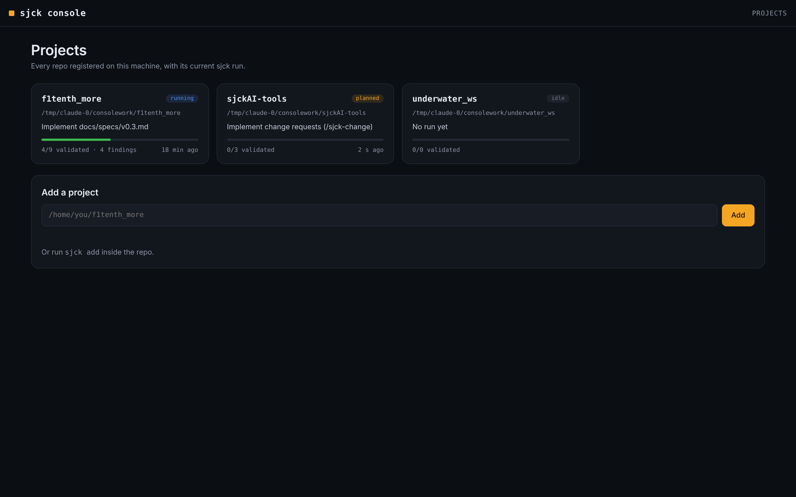

<div align="center">

# sjck

**Claude Code plugins that make agents work as a graph:
minimal context, parallel steps, every step validated before the next one.**

`sjck-graph` · `sjck-onboard` · `sjck console`


</div>

---

## Why

A single agent doing everything fills its context, gets lost in details and
carries mistakes forward. `sjck-graph` does the opposite:

- **It decides how much machinery a task needs.** Small task → it just does it.
  Large task → it breaks it into a DAG and runs agents in parallel.
- **Each agent sees only its card.** Goal, files it may touch, acceptance
  criteria. No exploring the repo.
- **No error reaches the next node.** A skeptical validator checks every node;
  the run only moves on with `verdict: pass`.
- **State lives in files.** `.sjck/state.json` is the single source of truth:
  if the session drops, the run resumes where it left off.
- **See everything, live.** The Run Viewer shows the graph, tokens and findings
  while the run is going.

## Install

Inside Claude Code, **one line at a time**:

```
/plugin marketplace add sjckness/sjckAI-tools
/plugin install sjck-graph@sjck
/plugin install sjck-onboard@sjck
```

Update with `/plugin marketplace update sjck`.

<details>
<summary>Without the plugin system</summary>

```bash
curl -fsSL https://raw.githubusercontent.com/sjckness/sjckAI-tools/main/install.sh | bash -s -- -g
```

Copies agents, commands and skills into `~/.claude`. Without the plugin there
are no hooks: no watchdog and no live viewer updates (use `/sjck-view`).
</details>

## 30-second tour

```
/sjck-onboard                                  # once per project: CLAUDE.md + module map
/sjck-plan add load/start/abort services to mission_manager_node
/sjck-run                                      # runs the approved plan
/sjck-view                                     # opens the Run Viewer in your browser
```

`/sjck-plan` is the kit's planning mode. It only asks the questions that change
the plan, compares at least two alternatives (nodes, critical path, estimated
tokens and time), runs an optimization checklist and explains each choice
(shared interfaces, disjoint files, node granularity, model and effort per
node, budgets), then hands over a `planned` state that `/sjck-run` executes
without re-planning. For small tasks it tells you so and advises against the
graph.

Other commands: `/sjck-status` (state without running anything), `/sjck-change` (change a running plan) and
`/sjck-eval --dry-run` (eval harness to compare kit versions; loads the
checked-out plugin with `--plugin-dir`).

For large tasks you don't even need `/sjck-run`: the `sjck-orchestration`
skill triggers on its own. Overrides always win:

```
/sjck-run refactor the logger --mode M
/sjck-run fix the parser, only use implementer and validator
```

## How it works

```
triage ──► S: inline ─────────────────► validator ─► done
       ├─► M: scout ► impl ► validator ─────────────► done
       └─► L: planner ► DAG ► [impl ► validator]×N ► reviewer ► done
                                ▲          │ fail (max 2)
                                └──────────┘
```

| Agent | Model | Effort | What it sees |
|---|---|---|---|
| planner | opus | high | the repo, once |
| scout | haiku | low | its card; extracts interfaces for the others |
| implementer | sonnet | medium | its card and the listed files |
| validator | sonnet | high | card, output JSON, diff |
| reviewer | opus | high | the aggregated diff |
| critic | fable | high | the proposal, plan score or findings, the goal — never code |

Agents pass **files** to each other in `.sjck/` (cards, interfaces, output
JSON), not chat summaries. The orchestrator only reads the JSON, so its context
grows by a few hundred tokens per node, not thousands.

### The graph's defenses

**Plan score.** Before running, `plan_score.py` computes DAG metrics (width per
level, critical path, file overlap between parallel nodes, tokens per card). A
`reject` verdict stops the run from starting; it is re-checked on nodes added
mid-run.

**Watchdog.** Plugin hooks: level 1 nudges the agent and blocks writes outside
the card's `files`; level 2 steps in if the pattern repeats or the budget goes
past 125%; level 3 belongs to the orchestrator, which decides what to do with
the blocked node. Hooks attribute each call to its node via `agent_id`
(validator, critic, reviewer and planner are ignored). Usage lives in
`.sjck/watchdog_state.json` and `watchdog.py usage` copies it into
`state.json` when a node completes.

**Findings and backlog.** Agents log out-of-scope issues in
`.sjck/findings.jsonl` instead of fixing them; at the end of each level the
orchestrator deduplicates them and proposes what goes into the plan or the
backlog.

**Critic.** A read-only `critic` reviews plans, findings and failed nodes and
answers approve or object, using a different model from the orchestrator.

State schema: [`sjck-graph/docs/state-schema.md`](sjck-graph/docs/state-schema.md).
Known limitations: [`sjck-graph/docs/limitations.md`](sjck-graph/docs/limitations.md).

## Run Viewer

One page, three views. It is regenerated on every write to `.sjck/` (hook) and
reloads itself while the run is in progress.

<table>
<tr>
<td width="50%"></td>
<td width="50%"></td>
</tr>
<tr>
<td><b>Tokens</b> — where each node's context goes (system, card, files
inside/outside the card, tool output, messages), kit vs single agent, and where
tokens are saved or wasted.</td>
<td><b>Findings</b> — what agents found out of scope: logged, not chased. You
decide whether and where it enters the plan.</td>
</tr>
</table>


**Graph** — nodes by level with status, model and effort, attempts, tool calls
against budget, and tokens. On the side: the critic's verdict, watchdog events,
log.

It works on a phone too, and degrades gracefully: with a v0.2 `state.json` it
shows the graph; tokens and findings appear once their files exist.

Try the demo without running anything:

```bash
python3 sjck-graph/scripts/graph_view.py --cwd examples/demo --open
```

<br clear="right">

## sjck console

A local web app for the machine where your repos live: every project in one
place, start **Plan** or **Run** from the browser, follow the Run Viewer live
and the agent log as it streams. Linux, macOS and Windows; Node ≥ 20, no
dependencies.


```bash
git clone https://github.com/sjckness/sjckAI-tools.git
npm i -g ./sjckAI-tools/console
cd ~/f1tenth_more && sjck add          # register a project
sjck serve                             # opens http://localhost:7777
```

It listens on localhost only and needs the token in the link it prints. Runs go
through your own Claude Code login (`claude -p`), never an API key in the page.
The console never writes the run state: the orchestrator stays its single
writer.

**Steer a live run.** The project page has three tabs next to the viewer:

- **Task** — Plan or Run, with the agent log streaming.
- **Chat** — talk with the planner (`sjck-change`) about the run in progress.
  Agreed changes become a change request in `.sjck/changes/`, with their impact
  (what re-runs, plan score, token estimate) shown before anything is written.
  The chat agent can only read and write change requests.
- **Inbox** — approve or reject change requests, accept / defer / reject
  findings, approve a `planned` plan. Decisions go to `.sjck/decisions/`; the
  orchestrator applies them at its next step with `inbox.py`, re-running only
  what a change invalidates.

<table>
<tr>
<td width="50%"></td>
<td width="50%"></td>
</tr>
</table>

**Notifications.** Toasts in the page, desktop notifications (button in the
top bar) when a node fails or blocks, a run ends, a plan is ready or a new
finding or change request arrives. For your phone, add a webhook such as
[ntfy](https://ntfy.sh) to `~/.sjck/console.json`:
`"notify": {"webhook": "https://ntfy.sh/<your-private-topic>"}`.

The same change requests work without the console: open a second Claude Code
session in the repo and use `/sjck-change`.

<details>
<summary>Home screen</summary>


</details>

## sjck-onboard

```
/sjck-onboard
/sjck-onboard only f1tenth_behavior
```

Produces a short `CLAUDE.md` (≈120 lines, loaded in every session) and one file
per module in `.claude/map/` (read only when needed). It never overwrites
hand-written lines and actually runs the build/test commands it documents.

## Roadmap

| Version | What |
|---|---|
| ✅ 0.3 | anti-loop watchdog, findings with approval, critic, model/effort per node, eval harness — [spec](docs/specs/v0.3.md) |
| **0.4** | token analytics from real transcripts, no-kit baseline — [spec](docs/specs/v0.4-token-analytics.md) |
| ✅ console 2 | chat with the planner, approvals, live change requests, notifications — [spec](docs/specs/console.md), [spec](docs/specs/change-requests.md) |
| 0.5 | memory across runs (`lessons.md`) |
| beyond | job runner for heavy workloads, multi-machine, agent optimizer |

Specs are executed with the kit itself:
`/sjck-run implement docs/specs/v0.4-token-analytics.md --mode L`.

## Contributing

Every change comes with a line in [`CHANGELOG.md`](CHANGELOG.md) and, when
possible, before/after run metrics. Licensed under [MIT](LICENSE).
