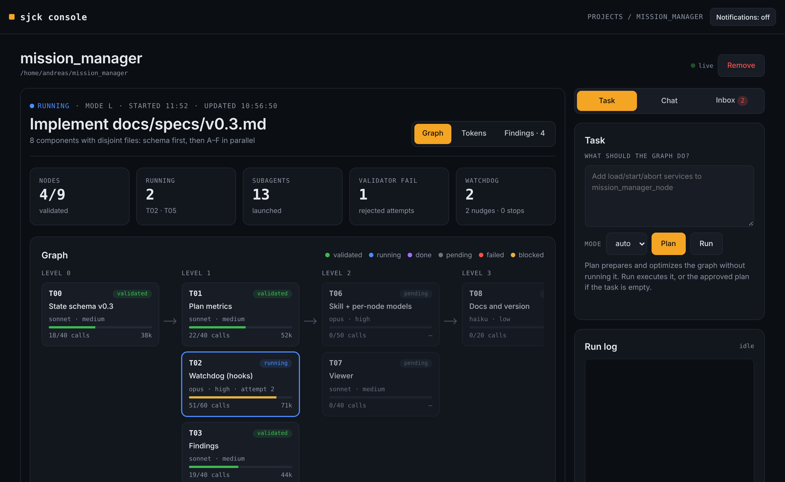
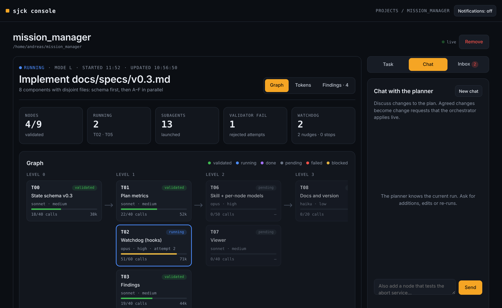
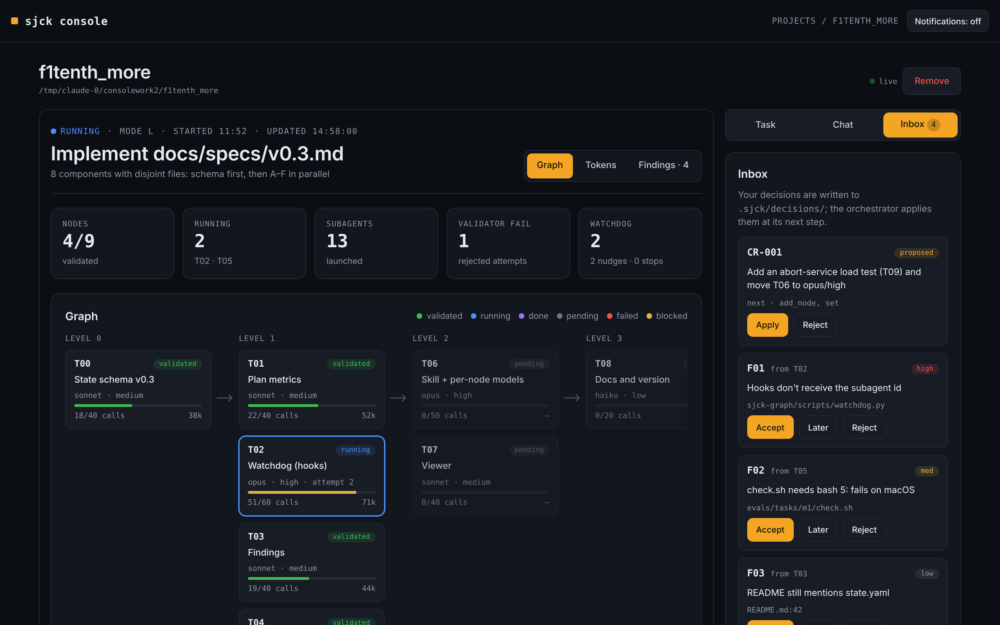
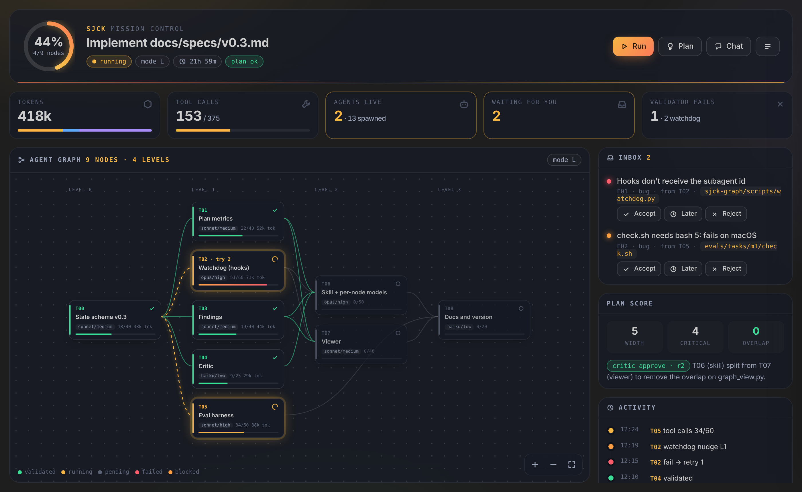

<div align="center">

# sjck

**Make Claude Code agents work as a graph:
minimal context per agent, independent steps in parallel,
every step validated before the next one starts.**

[Install](#installation) · [Quick start](#quick-start) · [How it works](#how-it-works) · [Console](#sjck-console) · [VS Code](#vs-code-extension) · [Roadmap](#roadmap)


</div>

---

## What's inside

| Component | What it is | You need it if… |
|---|---|---|
| **sjck-graph** | Claude Code plugin: planner, graph orchestration, validator, watchdog, findings, critic, live change requests, Run Viewer | always — it's the engine |
| **sjck-onboard** | Claude Code plugin: writes a compact `CLAUDE.md` and a per-module map of your repo | you want agents to stop re-exploring the repo |
| **sjck console** | Local web app: all your projects, Plan/Run from the browser, planner chat, approvals, notifications | you like a dashboard, or want to steer runs from the browser |
| **VS Code extension** | Native views: node tree, status bar, Explorer badges, Run Viewer tab, planner chat, inbox | you live in VS Code / Cursor |

All four read and write the same `.sjck/` folder in your project, so you can mix
them freely: start a run in the terminal, watch it in VS Code, approve a change
from the console.

## Why

A single agent doing everything fills its context, gets lost in details and
carries mistakes forward. sjck does the opposite:

- **It decides how much machinery a task needs.** Small task → done directly.
  Large task → split into a DAG, independent nodes run in parallel.
- **Each agent sees only its card**: goal, files it may touch, acceptance
  criteria. No exploring the repo.
- **No error reaches the next node.** A skeptical validator checks every node;
  the run moves on only with `verdict: pass`, at most two retries.
- **Agents that drift get stopped.** A watchdog catches loops, writes outside the
  card and blown budgets.
- **You stay in control while it runs.** Out-of-scope issues become findings you
  approve; plan changes become change requests applied live, re-running only what
  they invalidate.
- **State lives in files.** `.sjck/state.json` is the single source of truth: if
  the session drops, the run resumes where it left off.

---

## Installation

**One command, no clone.** It checks the requirements, installs the `sjck`
command (the console), adds both Claude Code plugins and — if VS Code is on your
`PATH` — installs the extension.

**Linux / macOS**

```bash
curl -fsSL https://raw.githubusercontent.com/sjckness/sjckAI-tools/main/get.sh | bash
```

**Windows** (PowerShell)

```powershell
irm https://raw.githubusercontent.com/sjckness/sjckAI-tools/main/get.ps1 | iex
```

Then check it:

```bash
sjck doctor
```

```
  ✓ Node.js        v22.11.0
  ✓ Claude Code    2.1.3 (Claude Code)
  ✓ Python ≥ 3.9   Python 3.12.4
  ✓ git            git version 2.43.0
  ✓ VS Code CLI    code 1.95.3
  ✓ plugin sjck-graph
  ✓ plugin sjck-onboard
```

That's it — jump to [Quick start](#quick-start).

### Requirements

| | Version | Needed for | Get it |
|---|---|---|---|
| Node.js | ≥ 20 | the installer, console, extension | [nodejs.org](https://nodejs.org) · `winget install OpenJS.NodeJS.LTS` · `brew install node` |
| [Claude Code](https://code.claude.com) | recent, logged in | everything | the installer adds it if missing; run `claude` once to log in |
| Python | ≥ 3.9 (standard library only) | the plugin's scripts | [python.org](https://www.python.org/downloads) (usually preinstalled on Linux/macOS) |
| VS Code / Cursor | optional | the extension | needs the `code` command on `PATH` (*Shell Command: Install 'code' command in PATH*) |

### What the installer does, step by step

If you prefer to do it by hand — or a step failed — these are the same steps.

**1. Console** (the `sjck` command)

```bash
npm i -g https://github.com/sjckness/sjckAI-tools/releases/latest/download/sjck-console.tgz
```

**2. Claude Code plugins** — either from your shell:

```bash
claude plugin marketplace add sjckness/sjckAI-tools
claude plugin install sjck-graph@sjck
claude plugin install sjck-onboard@sjck
```

or inside Claude Code, **one line at a time**:

```
/plugin marketplace add sjckness/sjckAI-tools
/plugin install sjck-graph@sjck
/plugin install sjck-onboard@sjck
```

Type `/` and you should see `/sjck-run`, `/sjck-plan`, `/sjck-change`…
(possibly prefixed, e.g. `/sjck-graph:sjck-run`).

**3. VS Code extension**

```bash
sjck vscode                    # or: sjck vscode --editor cursor
```

or download [`sjck.vsix`](https://github.com/sjckness/sjckAI-tools/releases/latest/download/sjck.vsix)
and use *Extensions → ⋯ → Install from VSIX…*. Works in Cursor and VSCodium too.

### Update

```bash
sjck update        # console + plugins + extension, to the latest release
```

### Options

| | |
|---|---|
| Skip parts | `curl … get.sh \| bash -s -- --no-vscode` (also `--no-plugins`); on Windows `$env:SJCK_SETUP_ARGS="--no-vscode"` before `irm … \| iex` |
| Pin a version | `SJCK_REF=v0.4.0` (Windows: `$env:SJCK_REF="v0.4.0"`) |
| Only the plugins | skip the console entirely and use step 2 |
| Uninstall | `npm rm -g sjck`, `claude plugin uninstall sjck-graph@sjck` (and `sjck-onboard@sjck`), remove the extension from VS Code; settings live in `~/.sjck/` |

<details>
<summary>Without the plugin system (copy files into <code>.claude/</code>)</summary>

```bash
# all projects (~/.claude)
curl -fsSL https://raw.githubusercontent.com/sjckness/sjckAI-tools/main/install.sh | bash -s -- -g
# or only the current project (./.claude)
curl -fsSL https://raw.githubusercontent.com/sjckness/sjckAI-tools/main/install.sh | bash
```

Copies agents, commands, skills and scripts. Without the plugin there are no
hooks: no watchdog and no live viewer updates (use `/sjck-view`).
</details>

<details>
<summary>From source (for development)</summary>

```bash
git clone https://github.com/sjckness/sjckAI-tools.git && cd sjckAI-tools
(cd console && npm pack && npm i -g ./sjck-*.tgz)      # pack first: it bundles the Run Viewer
(cd vscode && npm ci && npm run sync && npx @vscode/vsce package --no-dependencies && code --install-extension sjck-*.vsix)
claude plugin marketplace add ./ && claude plugin install sjck-graph@sjck
```
</details>

---

## Quick start

In a repo, inside Claude Code:

```
/sjck-onboard                                        # once per project: CLAUDE.md + module map
/sjck-plan add load/start/abort services to mission_manager_node
/sjck-run                                            # runs the approved plan
/sjck-view                                           # opens the Run Viewer in the browser
```

For large tasks you don't even need the commands: the `sjck-orchestration`
skill triggers on its own. Overrides always win:

```
/sjck-run refactor the logger --mode M
/sjck-run fix the parser, only use implementer and validator
```

While it runs, open a second Claude Code session (or the console chat) to change
the plan:

```
/sjck-change also add a load test for the abort service
```

### Commands

| Command | Does |
|---|---|
| `/sjck-plan <task>` | Planning mode: asks only what changes the plan, compares alternatives (nodes, critical path, tokens, time), optimizes, writes a `planned` state |
| `/sjck-run [task] [--mode S\|M\|L]` | Runs the task, or the approved plan if no task is given |
| `/sjck-change [request]` | Discuss changes to a planned or running graph; writes a change request |
| `/sjck-status` | Current state, without running anything |
| `/sjck-view` | Opens the Run Viewer |
| `/sjck-eval [--dry-run]` | Eval harness to compare kit versions |
| `/sjck-onboard [focus]` | Writes `CLAUDE.md` and `.claude/map/` |

---

## How it works

```
triage ──► S: inline ─────────────────► validator ─► done
       ├─► M: scout ► impl ► validator ─────────────► done
       └─► L: planner ► DAG ► [impl ► validator]×N ► reviewer ► done
                                ▲          │ fail (max 2)
                                └──────────┘
```

| Agent | Model | Effort | What it sees |
|---|---|---|---|
| planner | opus | high | the repo, once |
| scout | haiku | low | its card; extracts interfaces for the others |
| implementer | sonnet | medium | its card and the listed files |
| validator | sonnet | high | card, output JSON, diff |
| reviewer | opus | high | the aggregated diff |
| critic | fable | high | the proposal, plan score or findings, the goal — never code |

Model and effort can be set per node by the planner. Agents pass **files** to
each other in `.sjck/` (cards, interfaces, output JSON), not chat summaries: the
orchestrator reads only the JSON, so its context grows by a few hundred tokens
per node, not thousands.

### The graph's defenses

- **Plan score** — before running, DAG metrics (width, critical path, file
  overlap between parallel nodes, tokens per card). `reject` stops the run.
- **Watchdog** — hooks nudge an agent that loops or drifts, block writes outside
  its card, and stop it if it continues; the orchestrator decides what next.
- **Findings** — out-of-scope issues are logged, not chased; you decide at the
  end of each level whether they enter the plan or the backlog.
- **Critic** — a read-only agent on a different model reviews plans, findings
  and failures; two rounds, then you decide.
- **Live change requests** — `/sjck-change` and the console write change
  requests; the orchestrator applies them at a safe point with `inbox.py`,
  re-running only invalidated nodes and rolling back if the plan score breaks.

The orchestrator is the **only writer** of the run state. Everything else — the
chat, the console, VS Code — writes proposals and decisions it applies.

State schema: [`sjck-graph/docs/state-schema.md`](sjck-graph/docs/state-schema.md) ·
Known limitations: [`sjck-graph/docs/limitations.md`](sjck-graph/docs/limitations.md)

---

## Run Viewer

One page, three views, regenerated on every write to `.sjck/` and reloading
itself while the run is in progress. Try the demo without running anything:

```bash
python3 sjck-graph/scripts/graph_view.py --cwd examples/demo --open
```

<table>
<tr>
<td width="50%"></td>
<td width="50%"></td>
</tr>
<tr>
<td><b>Tokens</b> — where each node's context goes, kit vs single agent, where tokens are saved or wasted.</td>
<td><b>Findings</b> — what agents found out of scope, and where it could enter the plan.</td>
</tr>
</table>

---

## sjck console

A local web app for the machine where your repos live.

```bash
sjck add            # inside a repo: register it
sjck serve          # start, opens http://localhost:7777
sjck list           # projects and their status
```



- **Home** — every registered project with live status.
- **Task** — Plan or Run with the agent log streaming.
- **Chat** — talk with the planner about the run in progress; agreed changes
  become change requests, with their impact shown first.
- **Inbox** — apply/reject change requests, accept/defer/reject findings,
  approve a plan.
- **Notifications** — in the page, on the desktop, and on your phone through a
  webhook such as [ntfy](https://ntfy.sh): add
  `"notify": {"webhook": "https://ntfy.sh/<your-private-topic>"}` to
  `~/.sjck/console.json`.

<table>
<tr>
<td width="50%"></td>
<td width="50%"></td>
</tr>
</table>

**Security.** Listens on localhost only, requires the token in the printed link,
rejects foreign `Host` headers. Runs go through your own Claude Code login
(`claude -p`), never an API key in the page. The chat agent can only read files
and write change requests.

---

## VS Code extension

Native views over the same `.sjck/` folder, no console needed.



- **Mission Control** (new in 0.1.4) — a full panel with the live, animated
  graph (pan/zoom), a progress ring, KPIs (tokens, tool calls, live agents,
  what's waiting for you, validator fails), a drawer per node with card, files
  and diff, the inbox with one-click decisions, plan score and critic verdict,
  and an activity timeline. Updates arrive via `postMessage`, so nothing reloads.
- **Graph** view in the activity bar — levels and nodes with live status, model
  and effort, tool calls against budget, tokens. Click a node to open its card;
  open the diff of what a finished node changed.
- **Status bar** — `sjck 4/9 · T02 T05 · 2 waiting`.
- **Explorer badges** — `●` files a running node is working on, `!` files of a
  failed or blocked node, `✓` files changed by a validated node.
- **Run Viewer** in an editor tab, a restyled **planner chat** in the sidebar, **Inbox**
  with one-click approvals, **Plan / Run / Stop** from the view title.

Details and settings: [`vscode/README.md`](vscode/README.md).

---

## sjck-onboard

```
/sjck-onboard
/sjck-onboard only f1tenth_behavior
```

Produces a short `CLAUDE.md` (≈120 lines, loaded in every session) and one file
per module in `.claude/map/` (read only when needed). It never overwrites
hand-written lines and actually runs the build/test commands it documents.

---

## Troubleshooting

| Problem | Fix |
|---|---|
| Anything odd after installing | `sjck doctor` lists what's missing and how to fix it |
| `npm i -g` fails with EACCES (Linux/macOS) | use a Node version manager (nvm, fnm), or `npm config set prefix ~/.local` and add `~/.local/bin` to `PATH` |
| `sjck: command not found` after installing | open a new terminal; on Windows add the folder printed by `npm prefix -g` to `PATH` |
| `sjck vscode` says `code` not found | in VS Code: *Shell Command: Install 'code' command in PATH*, or `--editor cursor` |
| `/sjck-…` commands don't show up | `/plugin` → check that `sjck-graph@sjck` is enabled; restart Claude Code |
| `… is not a valid GitHub owner/repo shorthand` | paste the `/plugin` lines one at a time |
| Viewer doesn't update by itself | hooks need the plugin install (not `install.sh`); use `/sjck-view` |
| A run stopped half-way | run `/sjck-run` again: it resumes from `.sjck/state.json` |
| Old `.graph/` folder from v0.2 | rename it to `.sjck/` |
| Console link says "open with the link printed by `sjck serve`" | the token changes at every start: use the new link |
| VS Code views are empty | open a folder that contains `.sjck/state.json`, or run *sjck: Plan a task* |

---

## Roadmap

| | |
|---|---|
| ✅ 0.3 | watchdog, findings, critic, per-node model/effort, eval harness — [spec](docs/specs/v0.3.md) |
| ✅ console + VS Code | dashboard, planner chat, approvals, live change requests — [spec](docs/specs/console.md), [spec](docs/specs/change-requests.md) |
| **next** | **output chat**: ask what was done and why — per node, per file, per decision — answered from cards, diffs, validator reports and findings |
| then | token analytics from real transcripts, no-kit baseline — [spec](docs/specs/v0.4-token-analytics.md) |
| later | memory across runs (`lessons.md`), ROS 2 validator pack, Marketplace release |
| later | job runner for heavy workloads, multi-machine workers, agent optimizer |

Specs are executed with the kit itself:
`/sjck-plan implement docs/specs/v0.4-token-analytics.md`.

## Contributing

Every change comes with a line in [`CHANGELOG.md`](CHANGELOG.md) and, when
possible, before/after run metrics (`/sjck-eval`). Tests:

```bash
python3 -m unittest discover -s sjck-graph/tests      # plugin
(cd console && npm test)                              # console
(cd vscode && npm i && npm test)                      # VS Code extension
```

## License

[MIT](LICENSE) © Andreas Steffens
